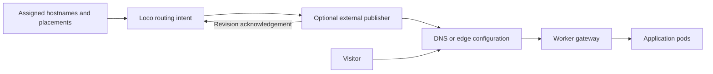

Loco's public routing API tells an external publisher which exact worker clusters may serve each application hostname. The publisher translates that intent into DNS or edge configuration. Application requests go through the configured edge and worker gateways; they do not call the Loco API.

An app domain is operator-managed until an installation administrator binds a publisher. Loco installs no DNS provider automatically. Existing operator-managed domains keep their current lifecycle.



## Bind a publisher

An installation administrator calls `loco.routing.v1.RoutingService.BindPublisher` with an app domain and any hostname prefixes reserved for installation infrastructure. For example, this reserves names beginning with `infra-` under `apps.example.com`:

```json
{
  "appDomain": "apps.example.com",
  "reservedPrefixes": ["infra-"]
}
```

The response contains `publisherId`. Binding imports existing assigned names through durable background work. Binding fails when a reserved prefix overlaps an assigned name. A domain has one binding; stopping or uninstalling its publisher leaves the binding and cleanup state intact.

Issue the publisher an owned token through `TokenService.CreateToken`, using a signed-in installation administrator session. Set its owner entity to `ENTITY_TYPE_ROUTING_PUBLISHER` and `entityId` to the binding's ID. Grant `SCOPE_READ` and `SCOPE_WRITE` on that same entity. This token can read and acknowledge that binding's intents. It cannot manage applications, create bindings or publish another domain's routes. Store the token in the publisher's own Secret.

## Consume intents

`ListRouteIntents` takes `publisherId`, a random process-lifetime `sessionId` UUID and `afterSequence`. Start from zero, process every page and retain `nextSequence` as the next cursor. `hasMore` requests another page. An empty page preserves the cursor. `sessionSeconds` gives a conservative lease budget measured from when the list call began; bound external work to that deadline. A process restart starts again from zero and reconciles the snapshot idempotently.

Each intent contains its stable `publicationId`, `revision`, hostname, resource/environment IDs, exact `clusterIds`, `preference: "nearest"`, `withdrawing` and `changeSequence`. Region names alone do not identify eligible clusters. The publisher configures nearby-region preference only among members of the supplied set.

Per-route revisions and change sequences serve different purposes. A revision identifies the desired contents of one publication. The binding's change sequence orders changed publications for pagination. Unchanged reconciliation and acknowledgements do not create new intent changes. Withdrawal tombstones remain in snapshots after their resource is deleted and after cleanup completes.

The session lease permits one active writer per binding. Successful list calls renew it and require both read and write permission because they claim the exclusive writer session. A different session waits for expiry. Run one publisher replica with a `Recreate` deployment strategy, renew during long batches, and bound provider request timeouts below the session lifetime. A stale provider request can still finish externally after intent changes; stale acknowledgements are rejected, and the publisher must repair external state from current intent.

For an empty cluster set with `withdrawing: false`, wait for a newer intent. No placement has qualified yet. For a withdrawal, delete only infrastructure the publisher owns, verify removal, then report success.

## Acknowledge publication

After reconciling and reading back external state, call `ReportPublication` with the binding, session, publication ID, exact revision and `PUBLICATION_OUTCOME_PUBLISHED`. Repeated success is idempotent and does not extend the drain window. The API rejects superseded revisions, expired sessions and cross-binding acknowledgements.

On provider failure, report `PUBLICATION_OUTCOME_ERROR` with safe text. Exclude secrets and provider response bodies. An error cannot authorize a placement retirement. Retry failed work and audit provider drift; a change feed alone does not detect changes made directly at the provider.

## Admission and retirement

A new cluster enters a hostname's mapping only after its current local route is accepted and resolved by the configured gateway, matches its desired hostname set and has serving replicas. All assigned names route locally. Gateway API allows 16 names per HTTPRoute, so larger sets use several routes and require acceptance of every route.

An admitted placement keeps its mapping through temporary pod failures or a failed new rollout. This mechanism does not implement automatic application health failover.

Removing a managed placement first publishes a set excluding that cluster. Its workload remains until all affected publications acknowledge their current revisions and the configured drain expires. Pending work and deadlines survive API restarts. A provider outage holds the removal.

Renaming or removing a managed hostname retains its old local route until external withdrawal is acknowledged and drained. Another resource cannot claim that hostname during cleanup. Explicit resource/workspace deletion keeps its existing immediate-stop behavior; durable tombstones finish external cleanup afterward. Suspension also keeps its existing immediate-stop policy. A live move between clusters in the same region is rejected for managed public apps until an explicit migration is arranged.

The drain window allows time for propagation; it does not move existing connections or guarantee every cache has expired. Validate the chosen publisher's propagation and connection behavior before switching production ownership. See [API environment](api-environment.md#public-routing-publication) for the generic settings.
